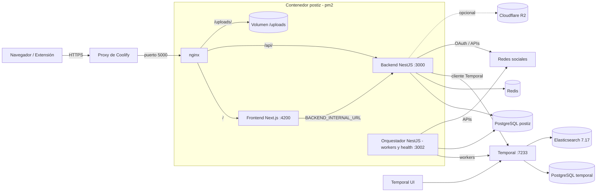
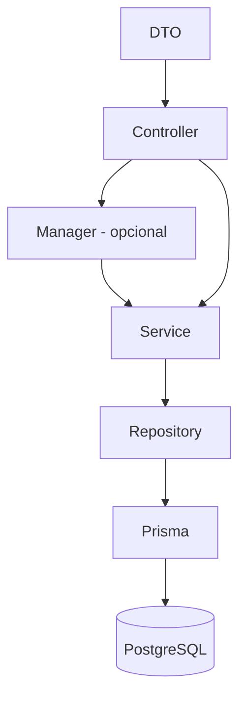
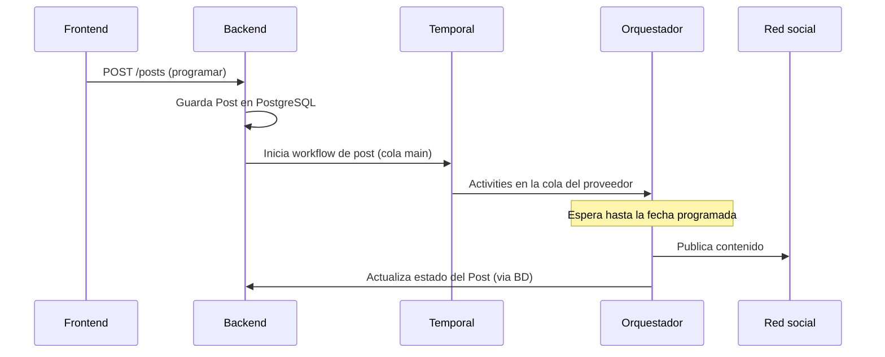

# Arquitectura

## Visión general

Postiz se compone de tres procesos de aplicación (frontend, backend, orquestador) más PostgreSQL, Redis y Temporal. En la imagen Docker de este repo los tres procesos corren **dentro de un mismo contenedor** (`postiz`), gestionados por `pm2`, detrás de un nginx que escucha en el puerto `5000`.

## Componentes

| Componente | Ruta | Rol |
|---|---|---|
| Backend | `apps/backend` | API REST (NestJS). Controladores delgados; la lógica vive en `libraries/nestjs-libraries`. Incluye API pública (`/public/v1`), servidor MCP y Copilot. Puerto `3000` (`PORT`). |
| Orquestador | `apps/orchestrator` | Workers de Temporal: workflows y activities (publicar posts, autopost, correos, video, refresco de tokens). Expone `GET /health/status` en `ORCHESTRATOR_PORT` (3002 por defecto). |
| Frontend | `apps/frontend` | Next.js (App Router) en el puerto 4200. |
| Extensión | `apps/extension` | Extensión de Chrome para integraciones basadas en cookies (p. ej. Skool). |
| Commands | `apps/commands` | Comandos CLI de NestJS: `run:agent`, `config:check`, `refresh`. |
| SDK | `apps/sdk` | Paquete `@postiz/node` para la API pública. |
| Librerías | `libraries/*` | `nestjs-libraries` (BD, DTOs, proveedores, agentes, pagos), `helpers` (utilidades compartidas), `react-shared-libraries`. |

## Capas del backend

Regla definida en `CLAUDE.md`: **DTO → Controller → Service → Repository** (o Controller → Manager → Service → Repository). Los controladores están en `apps/backend/src/api/routes`; servicios y repositorios en `libraries/nestjs-libraries/src/database/prisma/<feature>`. Prisma es la única vía a la base de datos (sin SQL crudo).

Autenticación y autorización:

- `AuthMiddleware` protege los controladores "autenticados" (`api.module.ts`); `PublicAuthMiddleware` protege la API pública (`/public/v1`).
- `PoliciesGuard` + `permissions.ability.ts` (CASL) aplican permisos por rol y suscripción.
- Throttling global con `@nestjs/throttler` y almacenamiento en Redis; límite por hora configurable con `API_LIMIT` (90 por defecto en código; los compose lo fijan en 30).
- Proveedores de login: GitHub, Google, Apple, Farcaster, wallet y OAuth genérico (`services/auth/providers`).

## Proveedores de redes sociales

Cada plataforma es un archivo `*.provider.ts` en `libraries/nestjs-libraries/src/integrations/social/` que implementa `social.integrations.interface.ts`. El código genérico no ramifica por proveedor. Hay unos 38 proveedores (X, LinkedIn, Facebook, Instagram, TikTok, YouTube, Reddit, Discord, Telegram, Bluesky, Mastodon, Threads, WordPress, etc.). Patrón análogo en `newsletter/providers`, `short-linking/providers` y `services/payment/providers`.

## Orquestación con Temporal

- `getTemporalModule` (`libraries/nestjs-libraries/src/temporal/temporal.module.ts`) se usa con `isWorkers=false` en el backend (solo cliente) y `true` en el orquestador.
- La cola `main` ejecuta los workflows; además hay una **task queue por proveedor** (solo activities) con concurrencia limitada por `maxConcurrentJob`.
- Variables: `TEMPORAL_ADDRESS`, `TEMPORAL_NAMESPACE`, `TEMPORAL_TLS`, `TEMPORAL_API_KEY`, `EXCLUDE_QUEUE`, `WORKER_CONCURRENCY_DIVIDER`.
- Los workflows de publicación están **versionados** (`post.workflow.v1.0.1` a `v1.1.2`) porque Temporal reproduce el historial contra el código actual: no se edita un workflow ya fusionado ni se cambian los parámetros de activities existentes.
- `InfiniteWorkflowRegister` arranca `missingPostWorkflow` (id `missing-post-workflow`) solo si `RUN_CRON` está definido.

El diagrama de secuencia es una simplificación basada en `CLAUDE.md` y en `post.workflow.v1.1.2.ts`; el detalle exacto del inicio del workflow no se ha trazado (**Por confirmar**).

## Dependencias externas

- **PostgreSQL 17** (app), **PostgreSQL 16** (Temporal), **Redis 7**, **Elasticsearch 7.17.27** (visibilidad de Temporal), **Temporal auto-setup 1.28.1** y **Temporal UI 2.34.0** (versiones de `docker-compose.coolify.yaml`).
- Almacenamiento: disco local (`/uploads`) o Cloudflare R2.
- Correo: Resend o nodemailer (`emails/`); sin proveedor, los usuarios nuevos se activan directamente.
- Pagos: Stripe y RevenueCat (opcionales).
- IA y terceros: OpenAI, HeyGen y ReelFarm (`3rdparties`), generación de video (`videos/`).
- Acortadores de enlaces: Dub, Short.io, Kutt, LinkDrip.
- Sentry (errores).

## Por confirmar

- Qué tan lejos se ha desviado el código del upstream `gitroomhq/postiz-app`.
- Qué proveedores sociales se usarán en producción (el compose de Coolify solo pasa un subconjunto de claves).
- Uso previsto de agentes, MCP y Copilot en este despliegue.
